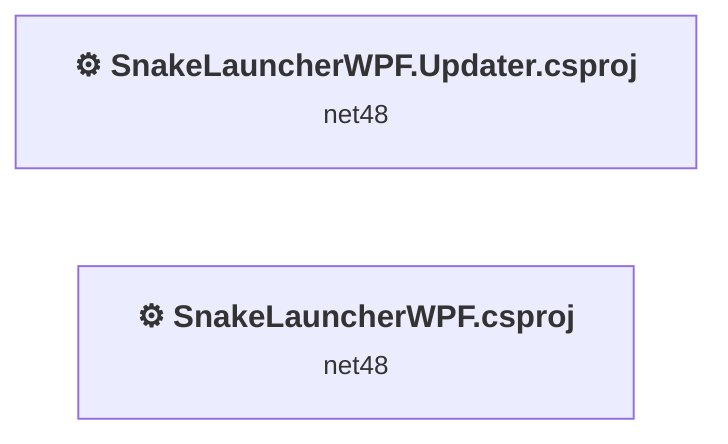
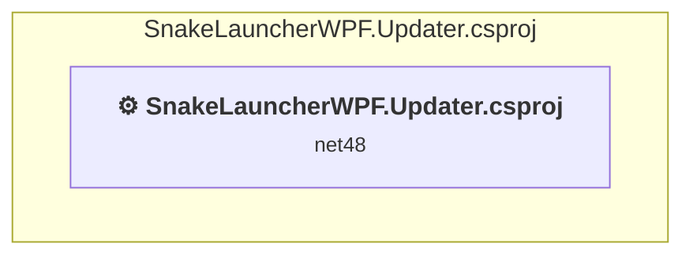
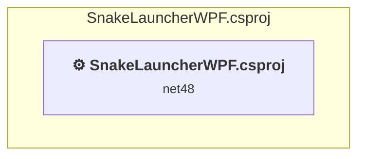

# Projects and dependencies analysis

This document provides a comprehensive overview of the projects and their dependencies in the context of upgrading to .NETCoreApp,Version=v10.0.

## Table of Contents

- [Executive Summary](#executive-Summary)
  - [Highlevel Metrics](#highlevel-metrics)
  - [Projects Compatibility](#projects-compatibility)
  - [Package Compatibility](#package-compatibility)
  - [API Compatibility](#api-compatibility)
  - [Binding Redirect Configuration](#binding-redirect-configuration)
- [Aggregate NuGet packages details](#aggregate-nuget-packages-details)
- [Top API Migration Challenges](#top-api-migration-challenges)
  - [Technologies and Features](#technologies-and-features)
  - [Most Frequent API Issues](#most-frequent-api-issues)
- [Projects Relationship Graph](#projects-relationship-graph)
- [Project Details](#project-details)

  - [E:\KernelDeleteDriver\SnakeLauncherWPF.Updater\SnakeLauncherWPF.Updater.csproj](#e:kerneldeletedriversnakelauncherwpfupdatersnakelauncherwpfupdatercsproj)
  - [SnakeLauncherWPF.csproj](#snakelauncherwpfcsproj)

## Executive Summary

### Highlevel Metrics

| Metric | Count | Status |
| :--- | :---: | :--- |
| Total Projects | 2 | All require upgrade |
| Total NuGet Packages | 10 | 4 need upgrade |
| Total Code Files | 17 |  |
| Total Code Files with Incidents | 19 |  |
| Total Lines of Code | 9232 |  |
| Total Number of Issues | 7367 |  |
| Estimated LOC to modify | 7354+ | at least 79.7% of codebase |

### Projects Compatibility

| Project | Target Framework | Difficulty | Package Issues | API Issues | Binding Issues | Est. LOC Impact | Description |
| :--- | :---: | :---: | :---: | :---: | :---: | :---: | :--- |
| [E:\KernelDeleteDriver\SnakeLauncherWPF.Updater\SnakeLauncherWPF.Updater.csproj](#e:kerneldeletedriversnakelauncherwpfupdatersnakelauncherwpfupdatercsproj) | net48 | 🟡 Medium | 0 | 464 | 0 | 464+ | ClassicWpf, Sdk Style = False |
| [SnakeLauncherWPF.csproj](#snakelauncherwpfcsproj) | net48 | 🟡 Medium | 9 | 6890 | 0 | 6890+ | ClassicWinForms, Sdk Style = False |

### Package Compatibility

| Status | Count | Percentage |
| :--- | :---: | :---: |
| ✅ Compatible | 6 | 60.0% |
| ⚠️ Incompatible | 0 | 0.0% |
| 🔄 Upgrade Recommended | 4 | 40.0% |
| ***Total NuGet Packages*** | ***10*** | ***100%*** |

### API Compatibility

| Category | Count | Impact |
| :--- | :---: | :--- |
| 🔴 Binary Incompatible | 7259 | High - Require code changes |
| 🟡 Source Incompatible | 70 | Medium - Needs re-compilation and potential conflicting API error fixing |
| 🔵 Behavioral change | 25 | Low - Behavioral changes that may require testing at runtime |
| ✅ Compatible | 7394 |  |
| ***Total APIs Analyzed*** | ***14748*** |  |

## Aggregate NuGet packages details

| Package | Current Version | Suggested Version | Projects | Description |
| :--- | :---: | :---: | :--- | :--- |
| Microsoft.Bcl.AsyncInterfaces | 10.0.8 | 10.0.12 | [SnakeLauncherWPF.csproj](#snakelauncherwpfcsproj) | 建议升级 NuGet 包 |
| System.Buffers | 4.6.1 |  | [SnakeLauncherWPF.csproj](#snakelauncherwpfcsproj) | 框架引用中包含 NuGet 包功能 |
| System.IO.Pipelines | 10.0.8 | 10.0.12 | [SnakeLauncherWPF.csproj](#snakelauncherwpfcsproj) | 建议升级 NuGet 包 |
| System.Memory | 4.6.3 |  | [SnakeLauncherWPF.csproj](#snakelauncherwpfcsproj) | 框架引用中包含 NuGet 包功能 |
| System.Numerics.Vectors | 4.6.1 |  | [SnakeLauncherWPF.csproj](#snakelauncherwpfcsproj) | 框架引用中包含 NuGet 包功能 |
| System.Runtime.CompilerServices.Unsafe | 6.1.2 |  | [SnakeLauncherWPF.csproj](#snakelauncherwpfcsproj) | ✅Compatible |
| System.Text.Encodings.Web | 10.0.8 | 10.0.12 | [SnakeLauncherWPF.csproj](#snakelauncherwpfcsproj) | 建议升级 NuGet 包 |
| System.Text.Json | 10.0.8 | 10.0.12 | [SnakeLauncherWPF.csproj](#snakelauncherwpfcsproj) | 建议升级 NuGet 包 |
| System.Threading.Tasks.Extensions | 4.6.3 |  | [SnakeLauncherWPF.csproj](#snakelauncherwpfcsproj) | 框架引用中包含 NuGet 包功能 |
| System.ValueTuple | 4.6.2 |  | [SnakeLauncherWPF.csproj](#snakelauncherwpfcsproj) | 框架引用中包含 NuGet 包功能 |

## Top API Migration Challenges

### Technologies and Features

| Technology | Issues | Percentage | Migration Path |
| :--- | :---: | :---: | :--- |
| WPF (Windows Presentation Foundation) | 4550 | 61.9% | WPF APIs for building Windows desktop applications with XAML-based UI that are available in .NET on Windows. WPF provides rich desktop UI capabilities with data binding and styling. Enable Windows Desktop support: Option 1 (Recommended): Target net9.0-windows; Option 2: Add <UseWindowsDesktop>true</UseWindowsDesktop>. |
| Windows Forms | 37 | 0.5% | Windows Forms APIs for building Windows desktop applications with traditional Forms-based UI that are available in .NET on Windows. Enable Windows Desktop support: Option 1 (Recommended): Target net9.0-windows; Option 2: Add <UseWindowsDesktop>true</UseWindowsDesktop>; Option 3 (Legacy): Use Microsoft.NET.Sdk.WindowsDesktop SDK. |
| GDI+ / System.Drawing | 10 | 0.1% | System.Drawing APIs for 2D graphics, imaging, and printing that are available via NuGet package System.Drawing.Common. Note: Not recommended for server scenarios due to Windows dependencies; consider cross-platform alternatives like SkiaSharp or ImageSharp for new code. |
| Legacy Configuration System | 2 | 0.0% | Legacy XML-based configuration system (app.config/web.config) that has been replaced by a more flexible configuration model in .NET Core. The old system was rigid and XML-based. Migrate to Microsoft.Extensions.Configuration with JSON/environment variables; use System.Configuration.ConfigurationManager NuGet package as interim bridge if needed. |

### Most Frequent API Issues

| API | Count | Percentage | Category |
| :--- | :---: | :---: | :--- |
| T:System.Windows.Thickness | 305 | 4.1% | Binary Incompatible |
| T:System.Windows.Media.Color | 247 | 3.4% | Binary Incompatible |
| T:System.Windows.Media.Brush | 229 | 3.1% | Binary Incompatible |
| T:System.Windows.Controls.UIElementCollection | 191 | 2.6% | Binary Incompatible |
| P:System.Windows.Controls.Panel.Children | 191 | 2.6% | Binary Incompatible |
| M:System.Windows.Controls.UIElementCollection.Add(System.Windows.UIElement) | 172 | 2.3% | Binary Incompatible |
| T:System.Windows.Controls.TextBlock | 167 | 2.3% | Binary Incompatible |
| T:System.Windows.GridLength | 146 | 2.0% | Binary Incompatible |
| T:System.Windows.Controls.Border | 141 | 1.9% | Binary Incompatible |
| T:System.Windows.RoutedEventHandler | 134 | 1.8% | Binary Incompatible |
| T:System.Windows.Controls.Button | 124 | 1.7% | Binary Incompatible |
| M:System.Windows.Thickness.#ctor(System.Double,System.Double,System.Double,System.Double) | 121 | 1.6% | Binary Incompatible |
| T:System.Windows.Controls.Grid | 118 | 1.6% | Binary Incompatible |
| T:System.Windows.HorizontalAlignment | 117 | 1.6% | Binary Incompatible |
| P:System.Windows.Controls.TextBlock.Text | 106 | 1.4% | Binary Incompatible |
| P:System.Windows.FrameworkElement.Margin | 104 | 1.4% | Binary Incompatible |
| T:System.Windows.Media.SolidColorBrush | 103 | 1.4% | Binary Incompatible |
| T:System.Windows.VerticalAlignment | 99 | 1.3% | Binary Incompatible |
| M:System.Windows.Media.SolidColorBrush.#ctor(System.Windows.Media.Color) | 94 | 1.3% | Binary Incompatible |
| T:System.Windows.Visibility | 92 | 1.3% | Binary Incompatible |
| T:System.Windows.Style | 92 | 1.3% | Binary Incompatible |
| P:System.Windows.ResourceDictionary.Item(System.Object) | 89 | 1.2% | Binary Incompatible |
| P:System.Windows.Controls.ContentControl.Content | 81 | 1.1% | Binary Incompatible |
| T:System.Windows.Media.Animation.EasingMode | 75 | 1.0% | Binary Incompatible |
| T:System.Windows.UIElement | 74 | 1.0% | Binary Incompatible |
| M:System.Windows.Media.Color.FromRgb(System.Byte,System.Byte,System.Byte) | 66 | 0.9% | Binary Incompatible |
| P:System.Windows.Controls.TextBlock.Foreground | 61 | 0.8% | Binary Incompatible |
| M:System.Windows.Controls.TextBlock.#ctor | 61 | 0.8% | Binary Incompatible |
| T:System.Windows.Controls.StackPanel | 58 | 0.8% | Binary Incompatible |
| P:System.Windows.Controls.TextBlock.FontSize | 56 | 0.8% | Binary Incompatible |
| P:System.Windows.FrameworkElement.Width | 54 | 0.7% | Binary Incompatible |
| T:System.Windows.DependencyProperty | 53 | 0.7% | Binary Incompatible |
| E:System.Windows.Controls.Primitives.ButtonBase.Click | 53 | 0.7% | Binary Incompatible |
| T:System.Windows.FontWeight | 52 | 0.7% | Binary Incompatible |
| M:System.Windows.Media.Color.FromArgb(System.Byte,System.Byte,System.Byte,System.Byte) | 48 | 0.7% | Binary Incompatible |
| T:System.Windows.Media.Animation.DoubleAnimation | 46 | 0.6% | Binary Incompatible |
| T:System.Windows.Point | 46 | 0.6% | Binary Incompatible |
| T:System.Windows.Threading.DispatcherTimer | 44 | 0.6% | Binary Incompatible |
| M:System.TimeSpan.FromMilliseconds(System.Double) | 43 | 0.6% | Source Incompatible |
| P:System.Windows.FrameworkElement.Height | 43 | 0.6% | Binary Incompatible |
| P:System.Windows.FrameworkElement.Style | 43 | 0.6% | Binary Incompatible |
| M:System.Windows.Media.Animation.DoubleAnimation.#ctor(System.Double,System.Double,System.Windows.Duration) | 41 | 0.6% | Binary Incompatible |
| M:System.Windows.Controls.Button.#ctor | 40 | 0.5% | Binary Incompatible |
| T:System.Windows.Media.ScaleTransform | 39 | 0.5% | Binary Incompatible |
| P:System.Windows.FrameworkElement.HorizontalAlignment | 39 | 0.5% | Binary Incompatible |
| P:System.Windows.GridLength.Auto | 38 | 0.5% | Binary Incompatible |
| T:System.Windows.Controls.ScrollBarVisibility | 36 | 0.5% | Binary Incompatible |
| T:System.Windows.CornerRadius | 36 | 0.5% | Binary Incompatible |
| T:System.Windows.Application | 35 | 0.5% | Binary Incompatible |
| P:System.Windows.Controls.Decorator.Child | 35 | 0.5% | Binary Incompatible |

## Projects Relationship Graph

Legend:
📦 SDK-style project
⚙️ Classic project

## Project Details

### E:\KernelDeleteDriver\SnakeLauncherWPF.Updater\SnakeLauncherWPF.Updater.csproj

#### Project Info

- **Current Target Framework:** net48
- **Proposed Target Framework:** net10.0-windows
- **SDK-style**: False
- **Project Kind:** ClassicWpf
- **Dependencies**: 0
- **Dependants**: 0
- **Number of Files**: 4
- **Number of Files with Incidents**: 5
- **Lines of Code**: 719
- **Estimated LOC to modify**: 464+ (at least 64.5% of the project)

#### Dependency Graph

Legend:
📦 SDK-style project
⚙️ Classic project

### API Compatibility

| Category | Count | Impact |
| :--- | :---: | :--- |
| 🔴 Binary Incompatible | 457 | High - Require code changes |
| 🟡 Source Incompatible | 3 | Medium - Needs re-compilation and potential conflicting API error fixing |
| 🔵 Behavioral change | 4 | Low - Behavioral changes that may require testing at runtime |
| ✅ Compatible | 622 |  |
| ***Total APIs Analyzed*** | ***1086*** |  |

#### Project Package References

| Package | Type | Current Version | Suggested Version | Description |
| :--- | :---: | :---: | :---: | :--- |

#### Project Technologies and Features

| Technology | Issues | Percentage | Migration Path |
| :--- | :---: | :---: | :--- |
| WPF (Windows Presentation Foundation) | 305 | 65.7% | WPF APIs for building Windows desktop applications with XAML-based UI that are available in .NET on Windows. WPF provides rich desktop UI capabilities with data binding and styling. Enable Windows Desktop support: Option 1 (Recommended): Target net9.0-windows; Option 2: Add <UseWindowsDesktop>true</UseWindowsDesktop>. |

### SnakeLauncherWPF.csproj

#### Project Info

- **Current Target Framework:** net48
- **Proposed Target Framework:** net10.0-windows
- **SDK-style**: False
- **Project Kind:** ClassicWinForms
- **Dependencies**: 0
- **Dependants**: 0
- **Number of Files**: 29
- **Number of Files with Incidents**: 14
- **Lines of Code**: 8513
- **Estimated LOC to modify**: 6890+ (at least 80.9% of the project)

#### Dependency Graph

Legend:
📦 SDK-style project
⚙️ Classic project

### API Compatibility

| Category | Count | Impact |
| :--- | :---: | :--- |
| 🔴 Binary Incompatible | 6802 | High - Require code changes |
| 🟡 Source Incompatible | 67 | Medium - Needs re-compilation and potential conflicting API error fixing |
| 🔵 Behavioral change | 21 | Low - Behavioral changes that may require testing at runtime |
| ✅ Compatible | 6772 |  |
| ***Total APIs Analyzed*** | ***13662*** |  |

#### Project Technologies and Features

| Technology | Issues | Percentage | Migration Path |
| :--- | :---: | :---: | :--- |
| Legacy Configuration System | 2 | 0.0% | Legacy XML-based configuration system (app.config/web.config) that has been replaced by a more flexible configuration model in .NET Core. The old system was rigid and XML-based. Migrate to Microsoft.Extensions.Configuration with JSON/environment variables; use System.Configuration.ConfigurationManager NuGet package as interim bridge if needed. |
| GDI+ / System.Drawing | 10 | 0.1% | System.Drawing APIs for 2D graphics, imaging, and printing that are available via NuGet package System.Drawing.Common. Note: Not recommended for server scenarios due to Windows dependencies; consider cross-platform alternatives like SkiaSharp or ImageSharp for new code. |
| Windows Forms | 37 | 0.5% | Windows Forms APIs for building Windows desktop applications with traditional Forms-based UI that are available in .NET on Windows. Enable Windows Desktop support: Option 1 (Recommended): Target net9.0-windows; Option 2: Add <UseWindowsDesktop>true</UseWindowsDesktop>; Option 3 (Legacy): Use Microsoft.NET.Sdk.WindowsDesktop SDK. |
| WPF (Windows Presentation Foundation) | 4245 | 61.6% | WPF APIs for building Windows desktop applications with XAML-based UI that are available in .NET on Windows. WPF provides rich desktop UI capabilities with data binding and styling. Enable Windows Desktop support: Option 1 (Recommended): Target net9.0-windows; Option 2: Add <UseWindowsDesktop>true</UseWindowsDesktop>. |

