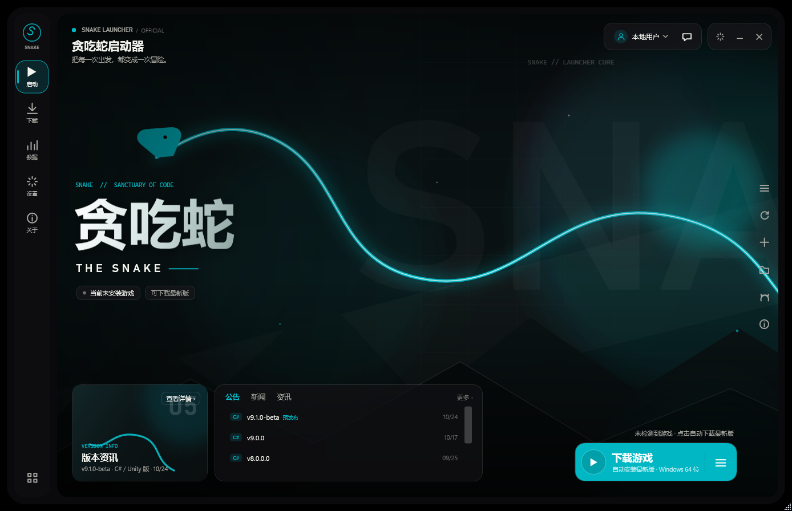
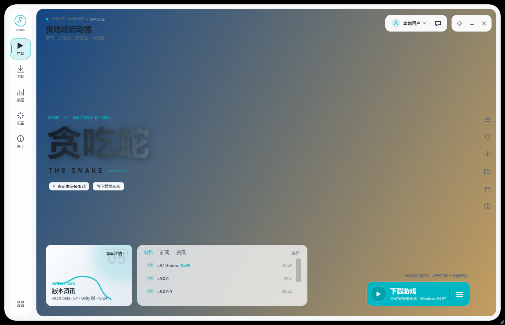
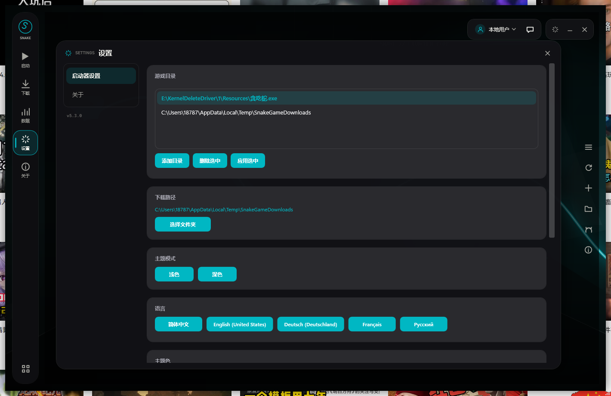
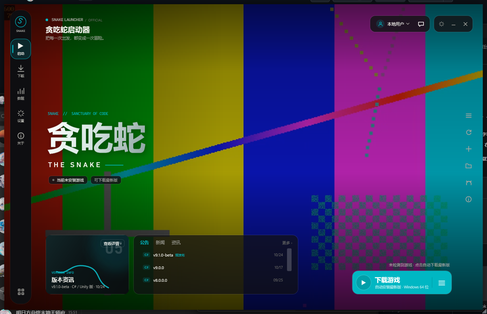

# SnakeLauncherWPF

<div align="center">

**为「自由贪吃蛇 / SnakeGame」系列打造的现代化游戏启动器**

*Hypergryph-style UI · .NET 10 · 一键下载安装 · 自定义背景 · 版本资讯*

[](https://www.microsoft.com/windows)
[](https://dotnet.microsoft.com/download/dotnet/10.0)
[](https://learn.microsoft.com/dotnet/desktop/wpf/)
[](https://github.com/MEIMAOA/SnakeLauncherWPF/releases)
[](LICENSE)

[功能特性](#-功能特性) · [截图](#-截图) · [下载](#-下载) · [从源码构建](#-从源码构建) · [更新日志](#-更新日志)

</div>

---

## 项目简介

**SnakeLauncherWPF** 是一个使用 **WPF / .NET 10（net10.0-windows）** 构建的现代化游戏启动器，为「自由贪吃蛇」系列提供多版本管理、游戏启动、进程守护、依赖自动化与安全校验能力；同时通过 **GitHub Releases** 获取两个游戏仓库的最新版本与更新说明。

界面参考鹰角网络（Hypergryph）启动器风格重新设计：无边框大圆角窗口、左侧独立导航栏 + 右侧内容面板分栏、全屏主视觉、底部公告/版本资讯与下载/启动胶囊按钮，并支持浅色模式与自定义背景。

### 项目定位

| 维度 | 描述 |
|:----:|:-----|
| **目标用户** | 贪吃蛇系列玩家、多版本测试人员、开发者 |
| **核心价值** | 统一管理游戏版本、实时数据同步、一键安装与更新、安全可信 |
| **技术栈** | WPF · .NET 10 · Named Pipe IPC · GitHub Releases · 自动更新 |

---

## ✨ 功能特性

### 界面 / 交互
- **鹰角风格布局**：大 R 角无边框窗口（R=32）、左侧独立导航栏与右侧内容面板由 12px 窗口边框带分隔、主视觉全屏铺满内容面板；
- **直接启动**：不再显示启动画面、无 3 秒等待，主窗口立即创建；
- **1 秒渐入 / 渐出**：启动整体淡入、关闭先淡出再退出（可被系统动画开关自动跳过）；
- **浅色 / 深色模式**：右上角一键切换（切换后自动重启生效）；
- **多语言**：简体中文、English、Deutsch、Français、Русский。

### 游戏管理
- **一键下载安装**：未检测到游戏时「开始游戏」变为「下载游戏」，自动从 GitHub Releases 选择最新发布版；
  - 自动识别系统架构（x64 / x86 / ARM64）；
  - 适配 `SnakeGame-X.X.X-beta-系统（Windows32 / Windows64 / Android）.zip / .apk` 命名格式；
  - 下载进度、校验、解压、静默安装、目录扁平化；
- **版本库**：浏览本地多版本、查看详情、打开目录、删除版本；
- **启动 / 停止 / 守护**：启动游戏进程、IPC 实时同步 FPS / 得分等状态、异常健康检查；
- **反作弊**：HMAC-SHA256 消息签名、EXE 哈希白名单、会话合理性追踪。

### 内容 / 资讯
- **版本资讯与公告**：自动拉取两个仓库的 GitHub Releases：
  - C# / Unity 版：`MEIMAOA/SnakeGame`
  - Python 版：`MEIMAOA/Snake-Game-Python-Edition-`
  - 每个版本的更新说明、预发布标记、发布日期；
- **自定义启动器背景**：设置中选择图片（PNG/JPG/JPEG/BMP/GIF/TIF）或视频（MP4/WMV/AVI/MOV/M4V），静音循环播放、最小化暂停，**不叠加白色滤镜 / 压暗层**，保持素材原色；
- **公告 / 新闻 / 资讯** 三个页签，支持「更多」展开完整更新说明。

---

## 📸 截图

| 深色首页 | 浅色首页 |
| --- | --- |
|  |  |

| 设置 | 自定义视频背景 |
| --- | --- |
|  |  |

> 更多截图见 [`SnakeLauncherWPF/_ui_preview/`](SnakeLauncherWPF/_ui_preview)。

---

## 📥 下载

前往 **[Releases](https://github.com/MEIMAOA/SnakeLauncherWPF/releases)** 下载最新版本（按系统架构选择）：

- `SnakeLauncherWPF_6.0.0.1-Windows64.zip` — Windows x64
- `SnakeLauncherWPF_6.0.0.1-Windows32.zip` — Windows x86（32 位）
- `SnakeLauncherWPF_6.0.0.1-WindowsARM64.zip` — Windows on ARM（ARM64）

解压后运行 `SnakeLauncherWPF.exe`，需要安装 [.NET 10 Desktop Runtime](https://dotnet.microsoft.com/download/dotnet/10.0)（三个包均为框架依赖发布，体积约 1 MB）。

首次启动会在程序目录生成 `launcher_config.json`（本地配置，不会提交到仓库）。

---

## 🛠️ 从源码构建

### 环境要求
- Windows 10 / 11（x64）
- [.NET 10 SDK](https://dotnet.microsoft.com/download/dotnet/10.0)（10.0.401 验证通过）

### 构建 / 运行

```powershell
git clone https://github.com/MEIMAOA/SnakeLauncherWPF.git
cd SnakeLauncherWPF/SnakeLauncherWPF
dotnet restore
dotnet build -c Release
.\bin\Release\net10.0-windows\SnakeLauncherWPF.exe
```

发布单目录版本：

```powershell
dotnet publish SnakeLauncherWPF/SnakeLauncherWPF.csproj -c Release -r win-x64 --self-contained false -o dist/win-x64
```

---

## 🔄 更新日志

### v6.0.0.1（2026-10-24）— 紧急修复

- 修复「仓库文档」面板中，鼠标移出 .md 文件行时崩溃的问题：
  `InvalidCastException: 无法将类型 'GitHubRelease' 的对象强制转换为类型 'System.String'`（文件行 `Tag` 保存的是 `GitHubRepoFile`，却被强转为 `string`）；
- 版本号更新至 6.0.0.1。

### v6.0.0（2026-10-24）
- **UI 重构**：参考鹰角网络启动器重新布局，无边框大圆角窗口 + 左侧独立导航栏 / 右侧内容面板分栏；
- **启动流畅化**：移除启动画面与 3 秒等待，改为直接启动 + 1 秒整体渐入；关闭 1 秒渐出；
- **左右分栏**：面板间距/外框统一 12px，内面板圆角 R=20 与窗口 R=32 同心，无描边线条；
- **左侧导航栏半透明**：浅色 / 深色主题分别适配；
- **浅色模式**：完整支持浅色主题与切换；
- **一键下载安装**：未检测到游戏时自动下载安装最新发布版，自动识别 x64/x86/ARM64，适配新命名格式与 `.apk`；
- **版本资讯 / 更新说明**：接入 GitHub Releases（C# / Unity 版 + Python 版），支持每个版本的更新说明与预发布标记；
- **自定义启动器背景**：支持图片与视频，静音循环、最小化暂停、不叠加滤镜；
- **版本号更新至 6.0.0**，升级至 .NET 10 / net10.0-windows。

### v5.3.0.1 及更早
见 [Releases](https://github.com/MEIMAOA/SnakeLauncherWPF/releases) 与 `SnakeLauncherWPF - 5.2.0.0/`（旧版本归档）。

---

## 🔗 相关仓库

- 游戏（C# / Unity 版）：<https://github.com/MEIMAOA/SnakeGame>
- 游戏（Python 版）：<https://github.com/MEIMAOA/Snake-Game-Python-Edition->

---

## 📄 许可证

本项目基于 [Apache License 2.0](LICENSE) 开源。